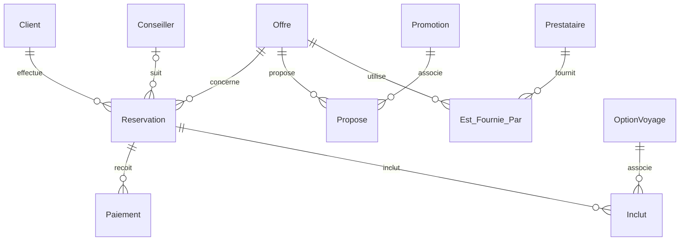

# Base de données de réservation de voyages

Projet réalisé par **Sébastien Ramirez et Raphaël de Robien** à l'EFREI, dans le cadre du cours **TI404 – Bases de données 1**.

La base représente une agence de voyages : clients, offres, réservations, paiements, prestataires, promotions et options. Le travail comprend l'analyse des besoins avec MERISE, un modèle conceptuel et 40 requêtes SQL.

Cette version reprend le [dépôt du binôme](https://github.com/raph907/ProjetDB_Ramirez_deRobien) et conserve son historique. Les fichiers ont été rangés et quelques requêtes et données d'exemple corrigées. Le modèle relationnel reste le même.

## Utiliser la base

Il faut un **serveur MySQL 8.0.16 ou plus récent**, avec les tables InnoDB, et un client comme MySQL Workbench ou `mysql`. Les versions antérieures à 8.0.16 n'appliquent pas les contraintes `CHECK` de ce projet.

Dans Workbench, ouvrir une connexion locale, créer une base vide puis la sélectionner :

```sql
CREATE DATABASE voyages CHARACTER SET utf8mb4 COLLATE utf8mb4_0900_ai_ci;
USE voyages;
```

Ouvrir et exécuter les quatre fichiers dans cet ordre, en gardant `voyages` comme schéma actif :

| Fichier | Contenu |
| --- | --- |
| `1_creation.sql` | Les 11 tables, clés primaires et clés étrangères. |
| `2_contraintes.sql` | Montants, dates, statuts, devises et autres règles de domaine. |
| `3_insertion.sql` | Données fictives : 10 clients, 6 offres, 12 réservations et leurs relations. |
| `4_interrogation.sql` | 10 filtres et tris, 10 agrégations, 10 jointures, 10 sous-requêtes. |

Avec le client en ligne de commande, lancer `mysql --default-character-set=utf8mb4 -u root -p` depuis le dossier du projet, puis utiliser les mêmes instructions de création de base et :

```sql
SOURCE 1_creation.sql;
SOURCE 2_contraintes.sql;
SOURCE 3_insertion.sql;
SOURCE 4_interrogation.sql;
```

Adapter le nom d'utilisateur à sa connexion. Les trois premiers scripts s'exécutent **une seule fois dans une base vide** : les relancer crée des erreurs de tables, de contraintes ou de clés déjà présentes. Pour refaire une installation, choisir une nouvelle base de test vide. Les scripts ne suppriment pas de base existante.

## Modèle relationnel

Une réservation concerne un client et une offre. Elle peut être suivie par un conseiller et réglée en plusieurs paiements. Les trois tables d'association permettent de relier plusieurs promotions ou prestataires à une offre, et plusieurs options à une réservation.



Le fichier [docs/modele.loo](docs/modele.loo) est le modèle de conception d'origine, à ouvrir avec Looping. Le diagramme ci-dessus résume les relations des scripts SQL ; il ne remplace pas ce document de cours.

## Exemple de consultation

Retrouver les réservations et leur client :

```sql
SELECT Reservation.reservation, Client.nom_client, Client.prenom_client
FROM Reservation
JOIN Client ON Reservation.client = Client.client;
```

Pour additionner les sommes réellement validées, on filtre les paiements avant le regroupement :

```sql
SELECT reservation, SUM(montant_paiement) AS total_paiements
FROM Paiement
WHERE statut_paiement = 'valide'
GROUP BY reservation;
```

Avec les données fournies, `R001` donne **980.00**, `R006` donne **2100.00** et `R010` donne **1750.00**. Les paiements en attente et remboursés ne sont pas comptés dans ce total.

## Règles et limites du projet

- Les clés étrangères empêchent les références vers un client, une offre ou une réservation inexistants.
- La suppression d'un conseiller laisse la réservation avec un conseiller `NULL`. Les autres relations utilisent les suppressions en cascade définies dans le script de création.
- Les contraintes vérifient notamment les montants et les dates, mais plusieurs colonnes restent facultatives. Un `CHECK` ne remplace pas `NOT NULL`.
- Les promotions sont associées aux offres ; elles ne recalculent pas automatiquement les prix. Le total des paiements n'est pas automatiquement rapproché du prix d'une réservation.
- Les dates des séjours et les coordonnées sont des exemples fixes. Le jeu de données a été corrigé pour placer les trois séjours hors période dans les dates de validité de leur offre. Cette règle n'est pas imposée automatiquement entre les tables.
- Le parrainage, la date et le moyen de paiement évoqués dans l'analyse initiale ne figurent pas dans les tables finales. Il n'y a pas d'interface web ni de système de réservation en ligne.

## Documents de cours

L'[analyse initiale](docs/conception-initiale.md) et le [prompt de génération des données](docs/prompt_insertion.txt) sont conservés dans `docs/`. Ils retracent la démarche du cours et les aides utilisées. L'analyse des besoins et le MCD sont attribués aux deux membres du binôme dans le document d'origine ; aucune répartition individuelle supplémentaire n'est revendiquée ici.

Voir [les vérifications et corrections](docs/verification.md) pour le détail des essais effectués sur cette version.
